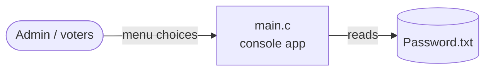

# eVoteX Online Voting System: High-Level Design

A menu-driven C console voting system: an admin password unlocks it, candidates are added, voters register and log in, and each voter can vote once. Results are shown per candidate. For code-level detail see the [Low-Level Design](lld.md).

## 1. Context

## 2. Features

| Feature | Detail |
|---|---|
| Admin unlock | Password checked against the first line of the password file |
| Candidates | Name and a short party sign, vote count (up to 5 candidates) |
| Voters | Username, ID, password, area, voted flag (up to 100 voters) |
| Session | Login / logout toggle per voter |
| Voting | One vote per logged-in voter, chosen by party sign |
| Results | Vote count per candidate |
| Election date | Displayed (10 April 2023) |

## 3. Tech

| Item | Choice |
|---|---|
| Language | C, colored output via `color.h` |
| Storage | In-memory arrays; data is lost on exit |
| Platform | Uses `system("cls")`, so the screen clearing works on Windows |
