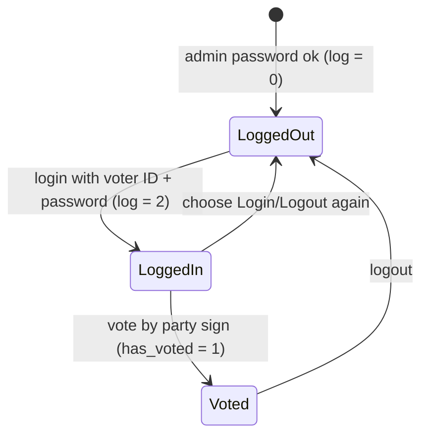
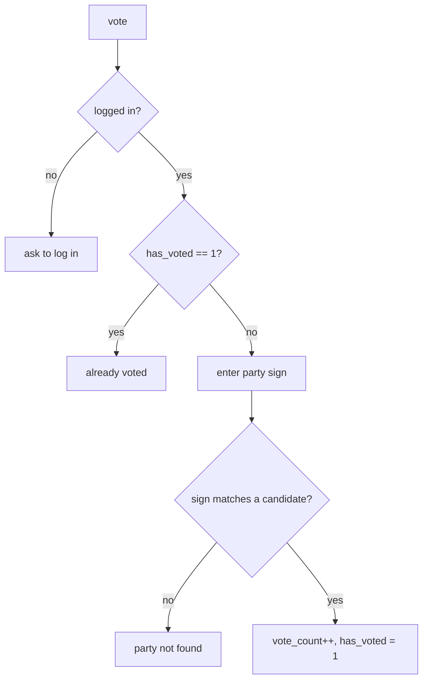

# eVoteX Online Voting System: Low-Level Design

For the big picture see the [High-Level Design](hld.md).

## 1. Data

```c
struct Date { unsigned int day, month, year; };

typedef struct voter {
    char uname[50];
    int id;
    char password[50];
    int area;
    int has_voted;      // 0 or 1
} voting;               // up to MAX_VOTERS (100)

typedef struct candidate {
    char fname[25], lname[25];
    char vote_sign[2];  // party sign
    int vote_count;
} candid;               // up to MAX_CANDIDATES (5)
```

## 2. Menu

| Choice | Function |
|---|---|
| 1 | `insert_candid` |
| 2 | `register_voter` (only when logged out) |
| 3 | `login_logout` |
| 4 | `update_profile` (logged in) |
| 5 | `display_voting_date` |
| 6 | `display_candidates` (shows the logged-in voter's profile and voted status) |
| 7 | `vote` (logged in, not yet voted) |
| 8 | `display_results` |
| 9 | Quit |

## 3. Session states



## 4. Vote



## 5. Notes

Voter passwords are kept in plain text in memory, the code opens `Password.txt` while the file in the repo is `password.txt` (fails on case-sensitive systems like Linux), and `system("cls")` is Windows-only.
